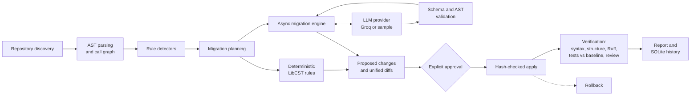

# CodeShift: AI-Assisted Sync-to-Async Migration Engine

CodeShift is a command-line tool and REST service that migrates Python code and checks its own work. Its main job is converting synchronous I/O code (`requests`, `time.sleep`) to `async`/`await` (`httpx`, `asyncio`). It also fixes a small set of deprecated standard-library APIs.

It combines four things:

- **Static analysis.** Python's `ast` module finds blocking calls and builds a repository-wide call graph, so the tool knows every function that must change together.
- **Syntax-preserving rewrites.** LibCST edits the code and keeps comments and formatting.
- **Validated LLM proposals.** A model (Groq by default) rewrites function bodies. Its output must pass schema and AST validation before it can become a proposed change.
- **Verification and rollback.** Every run is checked (syntax, structure, Ruff, the project's tests against a baseline) and can be undone.

## Contents

- [Why this exists](#why-this-exists)
- [What it does](#what-it-does)
- [Architecture](#architecture)
- [Installation](#installation)
- [Demonstration](#demonstration)
- [CLI reference](#cli-reference)
- [REST API](#rest-api)
- [Configuration](#configuration)
- [Migration rules](#migration-rules)
- [Verification pipeline](#verification-pipeline)
- [Safety and rollback](#safety-and-rollback)
- [Docker](#docker)
- [Using it in CI](#using-it-in-ci)
- [Testing](#testing)
- [Performance](#performance)
- [Known limitations](#known-limitations)
- [Future work](#future-work)
- [Troubleshooting](#troubleshooting)

## Why this exists

Moving a service from synchronous to asynchronous I/O is mechanical but easy to get wrong. Changing one function to `async def` forces every caller to `await` it, and a single missed call site returns a coroutine object where a value was expected. That bug does not raise an error until the value is used.

Asking an LLM to "make this async" does not solve the problem. The model sees one file, cannot know who calls the function, and nothing checks what it returns.

CodeShift splits the work by who is good at it. The call graph and the `await` propagation are deterministic. The model only rewrites function bodies, inside a fixed signature. Tests and static checks decide whether the result is accepted.

## What it does

| Capability | How |
|---|---|
| Find blocking I/O and its callers | `ast` call graph with import-aware name resolution |
| Convert functions to `async def` and await them everywhere | LibCST rewrite driven by the call graph |
| Rewrite `requests` calls to `httpx.AsyncClient` | LLM proposal (Groq) or the offline sample provider, then validation |
| Refuse unsafe conversions | Callbacks, lambdas, generator expressions, unknown decorators and more are reported, not changed |
| Fix deprecated APIs | Deterministic LibCST rules (`datetime.utcnow`, `logging.warn`, `collections` ABCs, `IOError`) |
| Verify | Syntax, structure, Ruff, unit tests, baseline comparison, review gate |
| Undo | Hash-checked rollback from stored backups |
| Record | SQLite history, text and JSON reports |

## Architecture



Each stage is a separate package under `src/codeshift/` with typed (Pydantic) inputs and outputs:

| Package | Responsibility |
|---|---|
| `discovery/` | Walk the repository read-only, honour `.gitignore`, build the manifest |
| `analysis/` | `ast` parsing, name resolution, call graph, detector runner, LibCST helpers |
| `rules/` | Rule registry and the built-in packs |
| `transformations/` | Deterministic rewrites, async migration engine, LLM reply validation |
| `llm/` | Provider interface, Groq/OpenAI-compatible adapter, sample provider, prompts, redaction |
| `orchestration/` | `MigrationRunner`: analyze, plan, apply, verify, rollback |
| `verification/` | The verification stages |
| `git/` | Unified diffs, working-tree status, hash-guarded apply and rollback |
| `storage/` | SQLite history and per-run artifacts |
| `reporting/` | Text and JSON reports |
| `api/` | FastAPI application |

More detail is in [docs/architecture.md](docs/architecture.md).

## Installation

Requires Python 3.12 or newer and Git.

```bash
git clone <your-fork-url> codeshift-ai && cd codeshift-ai
```

```bash
python -m venv .venv && source .venv/bin/activate
```

```bash
pip install -e ".[dev]"
```

```bash
codeshift --version
```

To use Groq, export a key (the tool works without one, using deterministic rules and the offline sample provider):

```bash
export GROQ_API_KEY=your_key_here
```

See [docs/installation.md](docs/installation.md) for Docker and `uv` instructions.

## Demonstration

`examples/legacy_service` is a small FastAPI order service. Its endpoints are synchronous and call two upstream services with `requests`. Its tests start a real local HTTP server, so the same tests are valid before and after the migration.

The output below is copied from real runs on Python 3.13 (macOS, Apple silicon). Paths are shortened to `/path/to`, and the plan's per-function notes are trimmed.

Work on a copy so the example stays pristine:

```bash
cp -R examples/legacy_service /tmp/legacy_service && cd /tmp
```

### 1. Scan

```bash
codeshift scan ./legacy_service
```

```text
CodeShift AI - Repository Analysis

Repository: /path/to/legacy_service
Git repository: yes
Python files discovered: 9
Files parsed successfully: 9
Files skipped: 0
Parse failures: 0
Target Python: 3.12
Test directories: tests
Configuration files: codeshift.toml

Potential migrations:
  Deprecated API patterns: 4
  Blocking I/O candidates: 5
  Legacy syntax patterns: 2

Scan time: 0.0081s

No source files modified.
```

### 2. Plan

```bash
codeshift plan ./legacy_service --llm sample
```

Use `--llm groq` instead to have Groq write the function bodies.

```text
Migration plan run_20261013_201300_da52c7
Repository: /path/to/legacy_service
Files analyzed: 9
Findings: 11
  async.sync-io-candidate: 5
  python.collections.abc: 1
  python.datetime.utcnow: 2
  python.except.bare: 1
  python.logging.warn: 1
  python.oserror-aliases: 1
LLM: sample (codeshift-sample-heuristic), 3 request(s), 0 rejected or failed, 0 redaction(s)

Proposed changes: 4 file(s)
  app/inventory_client.py    review required  rules: async.sync-io-candidate, python.logging.warn
  app/main.py    review required  rules: async.sync-io-candidate, python.datetime.utcnow
  app/pricing_client.py    review required  rules: async.sync-io-candidate
  tools/export_report.py    low risk  rules: python.collections.abc, python.oserror-aliases

Async group grp_1: converted
  functions: fetch_stock, reserve, PricingClient.quote_price, check_availability, create_order, stock,
PricingClient.quote_total

Async group grp_2: proposal only
  functions: archive
  blocked: archive: also calls subprocess.run() at line 40, which has no supported async equivalent

Async group grp_3: proposal only
  functions: throttle
  blocked: throttle: passed around as a value at tools/export_report.py:34

No source files modified.
Next: codeshift diff --run-id run_20261013_201300_da52c7
```

Three functions call `requests` directly. The call graph pulled in four more that call them, and all seven are converted together. Two other functions are left alone, with the reason stated.

### 3. Review the diff

```bash
codeshift diff
```

```diff
--- a/app/inventory_client.py
+++ b/app/inventory_client.py
-def fetch_stock(sku, retries=2):
+async def fetch_stock(sku, retries=2):
     """Return the quantity in stock for a SKU, retrying transient failures."""
-    for attempt in range(retries + 1):
-        try:
-            response = requests.get(f"{inventory_url()}/stock/{sku}", timeout=2)
-            response.raise_for_status()
-            return response.json()["quantity"]
-        except requests.RequestException:
-            if attempt == retries:
-                raise
-            logger.warn("inventory lookup failed for %s, retrying", sku)
-            time.sleep(RETRY_DELAY_SECONDS)  # simple fixed backoff
+    async with httpx.AsyncClient(follow_redirects=True, timeout=None) as client:
+        for attempt in range(retries + 1):
+            try:
+                response = await client.get(f"{inventory_url()}/stock/{sku}", timeout=2)
+                response.raise_for_status()
+                return response.json()["quantity"]
+            except httpx.HTTPError:
+                if attempt == retries:
+                    raise
+                logger.warning("inventory lookup failed for %s, retrying", sku)
+                await asyncio.sleep(RETRY_DELAY_SECONDS)  # simple fixed backoff
--- a/app/main.py
+++ b/app/main.py
 @app.post("/orders")
-def create_order(order: OrderRequest):
-    if not check_availability(order.sku, order.quantity):
+async def create_order(order: OrderRequest):
+    if not await check_availability(order.sku, order.quantity):
         raise HTTPException(status_code=409, detail="insufficient stock")
-    reservation_id = inventory_client.reserve(order.sku, order.quantity)
-    total = pricing.quote_total(order.sku, order.quantity)
+    reservation_id = await inventory_client.reserve(order.sku, order.quantity)
+    total = await pricing.quote_total(order.sku, order.quantity)
     return {
         "reservation_id": reservation_id,
         "total": total,
-        "created_at": datetime.utcnow().isoformat(),
+        "created_at": datetime.now(timezone.utc).isoformat(),
     }
```

(Excerpt. The full expected output is in `tests/fixtures/expected/legacy_service/`.)

### 4. Apply

```bash
codeshift apply --yes
```

```text
Run run_20261013_201300_da52c7: 4 file(s) to modify in /path/to/legacy_service
  app/inventory_client.py (review required)
  app/main.py (review required)
  app/pricing_client.py (review required)
  tools/export_report.py (low risk)
Applied 4 file(s).
Next: codeshift verify --run-id run_20261013_201300_da52c7 --run-tests
```

Without `--yes`, CodeShift asks for confirmation. In non-interactive mode it refuses with exit code 2.

### 5. Verify and report

```bash
codeshift verify --run-tests
```

```text
Migration Summary
-----------------
Run ID: run_20261013_201300_da52c7
Repository: /path/to/legacy_service
Status: verified
Files analyzed: 9
Files with proposed changes: 4
Files modified: 4
Transformations applied: 7
Findings: 11
LLM: sample / codeshift-sample-heuristic, 3 request(s), 0 rejected or failed
Async conversion groups: 1 converted, 2 left as proposals
Functions converted to async: 7

Verification:
  Syntax checks: PASS
      4 modified file(s) parsed
  Structural checks: PASS
      4 file(s) reparsed with ast and LibCST
      7 converted function(s) are async, free of supported blocking calls and awaited at every visible call site
  Static analysis: PASS
      ruff: 0 diagnostic(s) after, 0 before, 0 new (0.055s)
  Unit tests: PASS
      `python -m pytest -q -p no:cacheprovider` exited with 0 in 3.172s: 5 passed, 0 failed
  Regression check: PASS
      baseline: 5 passed, 0 failed; after: 5 passed, 0 failed
  Semantic review: PASS
      invariants hold and a reviewer approved the changes at apply time: app/inventory_client.py, app/main.py, app/pricing_client.py
  Checked: working tree

Overall status: PASSED

Action required:
  2 conversion group(s) were not changed and need manual work.

Timings: scan 0.0005s, analysis 0.0075s, transform 0.328s, verification 6.2836s
```

Export the same data as JSON:

```bash
codeshift report --format json --output report.json
```

### 6. Roll back

```bash
codeshift rollback
```

```text
Rolled back run run_20261013_201300_da52c7: 4 file(s) restored.
```

If any of the four files had been edited after the migration, the rollback would be refused and nothing restored.

More examples are in [docs/examples.md](docs/examples.md).

## CLI reference

| Command | Purpose | Writes to the repository |
|---|---|---|
| `codeshift scan PATH` | Summarise the repository and count candidates | No |
| `codeshift analyze PATH` | List findings (`--json`, `--rules`, `--fail-on-findings`) | No |
| `codeshift rules [PATH]` | List registered rules | No |
| `codeshift plan PATH` | Create a plan and proposed changes (`--rules`, `--llm`) | No |
| `codeshift diff` | Show the unified diff of a plan | No |
| `codeshift apply` | Apply a plan (`--yes`, `--non-interactive`, `--dry-run`) | Yes |
| `codeshift verify` | Run verification (`--run-tests` / `--no-run-tests`) | No |
| `codeshift rollback` | Restore the files a run changed | Yes |
| `codeshift history` | List previous runs | No |
| `codeshift report` | Print or export a report (`--format text\|json`, `--output`) | No |
| `codeshift purge --run-id ID` | Delete a run's stored proposals and backups | No |
| `codeshift serve` | Start the REST API | No |

Commands that take `--run-id` use the most recent run when it is omitted. Global options are `--log-level`, `--json-logs` and `--version`.

Exit codes are stable:

| Code | Meaning |
|---|---|
| 0 | Success |
| 1 | Internal error |
| 2 | Validation failure (stale file, missing approval, unknown run, unavailable provider) |
| 3 | Verification did not pass (failed, incomplete, or review required) |
| 4 | Configuration error |
| 5 | Findings present (`analyze --fail-on-findings`) |

## REST API

Start the service:

```bash
CODESHIFT_WORKSPACE_ROOT=/path/to/repos codeshift serve --port 8000
```

Interactive documentation is served at `/docs`.

| Method and path | Purpose |
|---|---|
| `GET /health` | Liveness check |
| `GET /rules` | Rule metadata |
| `POST /scan` | Scan a repository |
| `POST /analyze` | Return findings |
| `POST /plan` | Create a plan (returns `run_id`) |
| `GET /runs`, `GET /runs/{id}` | History and one run's report |
| `GET /runs/{id}/diff` | Unified diff as plain text |
| `POST /runs/{id}/apply` | Apply, with `{"approve": true}` |
| `POST /runs/{id}/verify` | Verify, optionally `{"run_tests": true}` |
| `POST /runs/{id}/rollback` | Roll back |
| `POST /transform` | Stateless: run deterministic rules on one source string |

Repositories are addressed relative to `CODESHIFT_WORKSPACE_ROOT`; paths that escape it are rejected. Set `CODESHIFT_API_TOKEN` to require `Authorization: Bearer <token>` on every endpoint except `/health`.

```bash
curl -s -X POST localhost:8000/plan -H 'content-type: application/json' -d '{"repo_path": "legacy_service", "llm": "sample"}'
```

## Configuration

CodeShift reads `codeshift.toml` in the repository, or `[tool.codeshift]` in its `pyproject.toml`. Every field is validated and unknown fields are errors. With no file, these defaults apply:

```toml
[project]
name = ""
# target_python = "3.12"     # default: lower bound of requires-python, if declared

[analysis]
include = []                 # gitignore-style globs; empty means all Python files
exclude = []
respect_gitignore = true

[rules]
enable = []                  # pack names or rule ids; empty means all
disable = []

[migrations]
auto_apply_low_risk = false
require_review_for_llm_changes = true
max_files_per_run = 200

[verification]
run_tests = false            # tests execute repository code, so this is opt-in
require_tests = true         # unexecuted tests make the result "incomplete"
run_ruff = true
run_mypy = false
fail_on_test_failure = true
baseline = true
test_command = []            # default: python -m pytest when tests are found
test_timeout_seconds = 600
isolation = "none"           # or "docker"

[llm]
enabled = false
provider = "groq"            # "groq", "openai-compatible" or "sample"
model = ""                   # default for groq: llama-3.3-70b-versatile
timeout_seconds = 60
max_retries = 2
max_context_chars = 24000
max_requests_per_run = 25
max_total_tokens = 200000
fallback = "none"            # "sample": use the offline provider if the API fails
redact_patterns = []         # extra regexes to redact before sending code
```

Environment variables:

| Variable | Purpose |
|---|---|
| `GROQ_API_KEY` | Groq credential. Read at run time, never stored |
| `CODESHIFT_LLM_API_KEY` | Credential for `openai-compatible` |
| `CODESHIFT_LLM_MODEL`, `CODESHIFT_LLM_BASE_URL` | Override the model or endpoint |
| `CODESHIFT_HOME` | State directory (default `~/.codeshift`) |
| `CODESHIFT_WORKSPACE_ROOT`, `CODESHIFT_API_TOKEN` | REST API root and optional token |

A full example with a project-specific rule is in `examples/migration_rules/codeshift.toml`.

## Migration rules

| Pack | Rule | Fix | Risk |
|---|---|---|---|
| `sync-to-async` | `async.sync-io-candidate` | Repo-wide engine (LLM for `requests`) | High, always reviewed |
| `sync-to-async` | `async.blocking-call-in-async` | Repo-wide engine | High, always reviewed |
| `deprecated-api` | `python.datetime.utcnow` | Deterministic | Medium (naive becomes aware) |
| `deprecated-api` | `python.logging.warn` | Deterministic | Low |
| `deprecated-api` | `python.collections.abc` | Deterministic | Low |
| `python-modernization` | `python.oserror-aliases` | Deterministic | Low |
| `python-modernization` | `python.except.bare` | Detect only | n/a |
| `python-modernization` | `python.syntax.target-version` | Detect only | n/a |

Rules match through imports, not names. `alarm.warn()` on an unrelated object and a local variable called `datetime` are left alone. Each rule's semantics, references and limits are documented in [docs/migration-rules.md](docs/migration-rules.md).

## Verification pipeline

| Stage | What it checks |
|---|---|
| Syntax | Every modified file parses, also against the target version's grammar |
| Structural | LibCST reparse; files match recorded hashes; fixed findings are gone; converted functions are async, have no supported blocking calls left, and are awaited at every visible call site; no function vanished or changed parameters |
| Static analysis | Ruff (and optionally mypy) on the modified files; only diagnostics that are new compared to the baseline fail |
| Unit tests | The project's tests, in a temporary copy of the repository |
| Regression | The same tests on a baseline copy; failures are split into "introduced by the migration" and "already failing before" |
| Semantic review | AI-assisted and high-risk changes need the invariants above to hold and a recorded human approval |

The overall status follows fixed rules:

- A failed mandatory stage gives `failed`.
- A mandatory stage that did not run gives `incomplete`. Tests that were not executed are never counted as passing.
- An outstanding review gives `review_required`.
- Otherwise `passed`.

`codeshift verify` also works on a plan that has not been applied. It then checks a temporary copy with the proposed changes, so you can see test results before touching your working tree.

## Safety and rollback

- `scan`, `analyze`, `plan`, `diff` and `verify` never write to the repository.
- `apply` needs explicit approval. Changes marked "review required" cannot be auto-applied.
- A file is only written if its hash still matches the hash recorded at planning time. If any file has changed, nothing is applied.
- Originals are backed up before writing. Writes are atomic per file, and a failure part-way restores the files already written.
- `rollback` only restores a file if it still matches what the run wrote. Otherwise it refuses.
- CodeShift only ever runs `git status` and `git rev-parse`. It never resets, cleans, checks out or commits.
- Analysis never imports or executes repository code. Tests run only when enabled, in a temporary copy, with a timeout and with secret-looking environment variables removed.
- Source sent to a hosted model is limited to the function, its imports and a few call sites. Secrets are redacted first, and repository text is framed as untrusted data.

The full model, including what Docker isolation does and does not protect against, is in [docs/safety-model.md](docs/safety-model.md).

## Docker

```bash
docker build -t codeshift-ai .
```

Analyse a repository mounted read-only:

```bash
docker run --rm -v "$PWD/examples/legacy_service:/workspace:ro" codeshift-ai scan /workspace
```

Plan with history kept in a named volume:

```bash
docker run --rm -v "$PWD/examples/legacy_service:/workspace:ro" -v codeshift-data:/data codeshift-ai plan /workspace --llm sample
```

Applying needs a writable mount. On a read-only mount it fails with a clear message and exit code 2:

```bash
docker run --rm -v "$PWD/my-project:/workspace:rw" -v codeshift-data:/data codeshift-ai apply --yes
```

Run the REST API (the image's default command):

```bash
docker compose up
```

The image runs as a non-root user, contains no credentials, and stores history under `/data`, outside the mounted repository. Pass `GROQ_API_KEY` with `-e` at run time.

## Using it in CI

`.github/workflows/ci.yml` runs formatting, lint, type checking, unit tests, integration and end-to-end tests with coverage, a package build that is installed into a clean environment, and a Docker build that checks the read-only behaviour.

`.github/workflows/codeshift-build-step.yml` shows CodeShift as a build step: it plans a migration, verifies the proposal including tests in a temporary copy, uploads the diff and JSON report as artifacts, and fails the build while fixable deprecated APIs remain.

## Testing

```bash
./scripts/run_checks.sh
```

Or only the tests:

```bash
pytest
```

Current state on Python 3.13: **106 tests pass, 90% line coverage**. Tests never call an external API. The provider is either the offline sample provider, a scripted mock, or an `httpx.MockTransport`.

| Suite | Covers |
|---|---|
| `tests/unit` | Discovery, config validation, detectors, LibCST rewrites, import handling, call graph, async engine and its refusal cases, LLM reply validation, redaction, retries, storage, hash safety, diff, status aggregation |
| `tests/integration` | Full pipeline on temporary repositories: expected-file comparison, invalid LLM output rejected, syntax errors and failing tests block success, pre-existing failures separated, user edits preserved, rollback refusal, incremental cache |
| `tests/e2e` | The documented workflow through the CLI and through the REST API |

## Performance

Measured with `scripts/benchmark.py`, which generates a synthetic repository where every module has one `requests` function, two callers and three deprecated API uses, then times each stage (median of 3 runs, Python 3.13.13, macOS arm64, offline sample provider).

| Files | Scan (s) | Scan + analyze (s) | Full plan (s) | Files changed | Functions converted |
|---:|---:|---:|---:|---:|---:|
| 51 | 0.001 | 0.038 | 7.349 | 50 | 150 |
| 201 | 0.005 | 0.184 | 29.303 | 200 | 600 |

Analysis is fast because it uses the C-implemented `ast` parser. Planning is dominated by LibCST, a pure-Python tree rewrite with metadata passes; it costs roughly 0.15 s per changed file and grows linearly. This benchmark changes every file, which is a worst case. With a hosted model, network latency per function is added on top.

Reproduce with:

```bash
python scripts/benchmark.py --files 50 200 --repeat 3
```

Unchanged files are served from a hash-keyed findings cache on repeated `analyze` runs when only file-local rules are selected. No speed-up is claimed for it here because it was not benchmarked.

## Known limitations

- **Narrow async support.** Only `time.sleep` and module-level `requests.<verb>()` calls are converted. `requests.Session`, database drivers, `subprocess`, file I/O and other SDKs are detected at most, never rewritten.
- **Callers must be visible.** The call graph is static. Calls through `getattr`, dependency injection containers, or other repositories are invisible, which is why every async change is marked for review and why tests matter.
- **Method calls on objects are matched by name.** `client.fetch()` is linked to a method only if exactly one class in the repository defines `fetch`. Such matches are flagged in the plan.
- **Framework support.** Route handlers become `async def` only in modules that import FastAPI or Starlette. Flask, Django and Celery entry points are refused.
- **Transitive blocking is not tracked.** If a converted handler also calls an unrelated blocking function (for example a synchronous database query), that call now blocks the event loop. CodeShift only blocks the conversion when the function itself contains a known unsupported blocking call.
- **`requests` and `httpx` are not identical.** Exception classes are mapped approximately, `response.ok` does not exist in httpx, and a new client is opened per call. These are listed as notes on each plan.
- **Test mocks are not rewritten.** `mock.patch("requests.get")` is flagged, not fixed. Direct calls from synchronous tests are wrapped in `asyncio.run(...)`.
- **Import placement.** New imports are added after the existing ones, not sorted. Projects that lint import order will see that as a new diagnostic.
- **Groq adapter.** It is tested against a mocked HTTP transport, not the live Groq API (no key was available during development). Output quality depends on the model.
- **Python only.** No JavaScript, TypeScript or Java support.
- **Docker test isolation** is implemented (`verification.isolation = "docker"`) but is not covered by automated tests.

## Future work

- More async targets: `requests.Session` to a shared `httpx.AsyncClient`, `asyncio.to_thread` wrapping for unsupported blocking calls.
- Rewriting test mocks alongside the code they patch.
- Type-informed method resolution to replace name matching.
- Language adapters. Discovery, the registry, orchestration, verification and storage are language-neutral; a new language needs a parser, detectors and a rewrite backend behind the `Rule` interface.

## Troubleshooting

| Symptom | Cause and fix |
|---|---|
| `LLM provider 'groq' is enabled but no API key was found` | Export `GROQ_API_KEY`, or plan with `--llm sample` or `--llm off` |
| Plan shows `proposal only` with `requires an LLM provider` | The function uses `requests`; add `--llm sample` or `--llm groq` |
| `refusing to apply: file(s) changed since the run recorded them` | The file was edited after planning. Run `codeshift plan` again |
| `refusing to roll back` | The file was edited after the migration. Revert that edit or undo by hand with the stored diff |
| `Overall status: INCOMPLETE` | Tests were not executed. Run `codeshift verify --run-tests` |
| Unit tests fail with `ModuleNotFoundError` in verification | Tests run with the interpreter CodeShift is installed in. Install the project's dependencies there, or set `verification.test_command` |
| `cannot write to the repository (read-only mount ...)` | Mount the repository `:rw` to apply |
| `exceed migrations.max_files_per_run` | Narrow with `--include`/`--exclude` or raise the limit |
| `cannot open the CodeShift state directory` | Set `CODESHIFT_HOME` to a writable directory |

## License

MIT. See [LICENSE](LICENSE).
