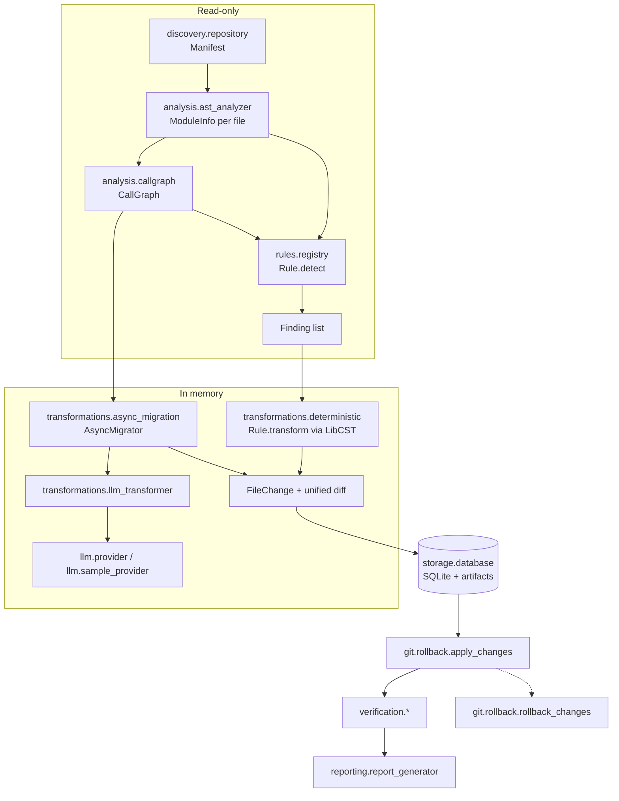

# Architecture

CodeShift is a pipeline. Each stage has typed inputs and outputs and can be tested alone.

## Core data models

All models are Pydantic classes with `extra="forbid"`.

| Model | Module | Meaning |
|---|---|---|
| `Manifest`, `FileEntry` | `discovery/manifest.py` | What the scan found, with a SHA-256 per file |
| `Finding` | `models/findings.py` | One rule match: location, severity, confidence, excerpt, fix kind |
| `RuleSpec` | `models/migrations.py` | Rule metadata: pack, risk, review requirement, references |
| `TransformationResult` | `models/migrations.py` | One file rewritten in memory, with before and after hashes |
| `FileChange` | `models/migrations.py` | A persisted proposal: hashes, rule ids, origin, diff, status |
| `ConversionGroup`, `Proposal` | `models/migrations.py` | Async conversion units and the ones left for a person |
| `MigrationPlan`, `RunRecord` | `models/` | Everything a run decided, and its lifecycle state |
| `StageResult`, `VerificationResult` | `models/verification.py` | Per-stage and overall verification status |
| `MigrationRequest`, `MigrationResponse` | `llm/schemas.py` | The contract with the model |

## Core interfaces

- **`Rule`** (`rules/registry.py`): `spec`, `detect(module, ctx)` and optionally `transform(module)`. Rules marked `repo_wide` only detect; their rewrite needs the whole call graph.
- **`LLMProvider`** (`llm/base.py`): `generate_migration(request, feedback) -> LLMReply`. Providers return text only.
- **`MigrationRunner`** (`orchestration/migration_runner.py`): `analyze`, `plan`, `apply`, `verify`, `rollback`. The CLI and the REST API are thin layers over it.

## How name resolution works

`ModuleInfo` records every import as `local name -> qualified name` and every name that is rebound (assignments, parameters, definitions). `resolve()` turns `dt.datetime.utcnow` into `datetime.datetime.utcnow` only when the head name is an import that is never rebound. This is why a parameter called `datetime` or a class with a `warn` method does not match.

Rewrites use LibCST's scope-aware `QualifiedNameProvider`. Detection and rewriting are therefore two independent implementations, and structural verification checks one against the other: after a rewrite, the detector must stop reporting the finding.

## How the async migration works

1. **Seeds.** Functions outside tests that directly call `time.sleep` or `requests.<verb>`.
2. **Closure.** For each synchronous seed, walk the call graph upward. Every synchronous caller must also become a coroutine, then its callers, and so on. Callers that are already `async` only need an `await`.
3. **Groups.** Seeds whose closures overlap are merged. A group converts completely or not at all.
4. **Blockers.** A group is refused if any member is a generator, a special method, a nested function, a method of a class with base classes, decorated with something not known to accept coroutines, passed around as a value, or also calls an unsupported blocking API. It is also refused if any call site is in a lambda, a generator expression, or at module level.
5. **Bodies.** For seeds that use `requests`, the provider is asked for a replacement function. The reply is validated (see [safety-model.md](safety-model.md)). Only the body and the `async` keyword are taken from it; the name, parameters, decorators and annotations stay from the original.
6. **Propagation.** The sources are re-analysed, then one LibCST pass per file adds `async`, wraps call sites in `await` (with parentheses where precedence needs them), replaces `time.sleep` with `asyncio.sleep`, wraps calls from synchronous tests in `asyncio.run(...)`, and fixes imports.
7. **Consistency check.** A fresh call graph of the result must show every converted function as async, free of supported blocking calls, and awaited at every call site. If not, no async change is proposed at all.

## Persistence

`CODESHIFT_HOME` (default `~/.codeshift`) holds:

- `codeshift.db`: tables `runs` (one JSON record per run), `changes` (file hashes and status) and `analysis_cache` (findings keyed by file hash and rule set).
- `runs/<run_id>/proposed/` and `runs/<run_id>/backup/`: the proposed content and the originals, only for files the run changes. `codeshift purge` deletes them.

Nothing is written inside the target repository except the files a run applies.

## Adding a language

Discovery, the registry, orchestration, verification stages for tests, storage and reporting do not depend on Python syntax. A new language needs a parser producing its own module info, detectors and rewrites implementing `Rule`, and syntax and structural verifiers. The rule's `language` field exists for that selection; only `python` is implemented.
